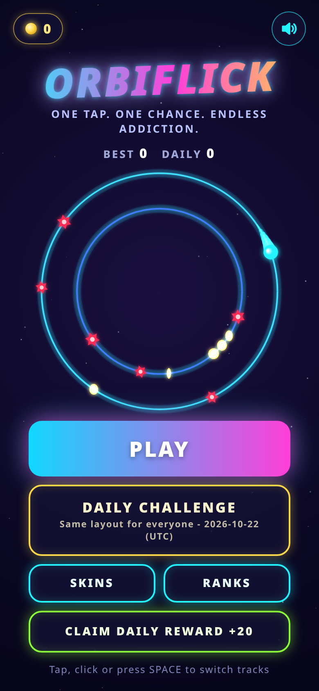
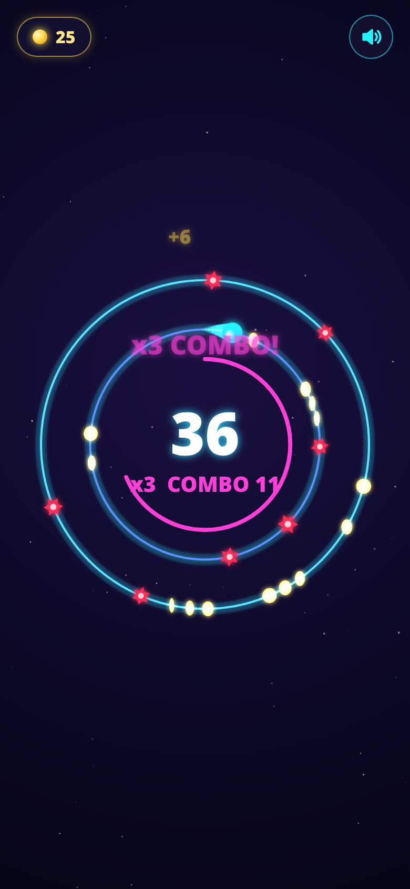

# OrbiFlick

**One Tap. One Chance. Endless Addiction.**

A one-tap arcade game: a neon ball circles two tracks. Tap to flick between the inner and outer track, dodge the red obstacles and grab coins. The speed starts at 50% and goes up 10% every 150 points.

 

## Play
Open `index.html` in any phone or desktop browser. Tap, click, or press Space to switch tracks.

## Features
- Combo multiplier up to x9, near-miss bonus, coins
- 8 unlockable skins with trail effects
- Daily challenge (same layout for everyone each day) and daily reward streak
- Second chance (placeholder for a rewarded ad), share button, local top-10 leaderboard
- Synth sound effects and haptics

## Docs
- [Release plan (PDF)](docs/OrbiFlick_Release_Plan.pdf) / [Markdown](docs/OrbiFlick_Release_Plan.md)

## Tests
Playwright scripts are in `tests/` (`npm install` then `node run.js`). They may need their file paths adjusted to point at `index.html`.

> Before release, remove the `window.ORBIFLICK` debug hook.
